<p align="center">
  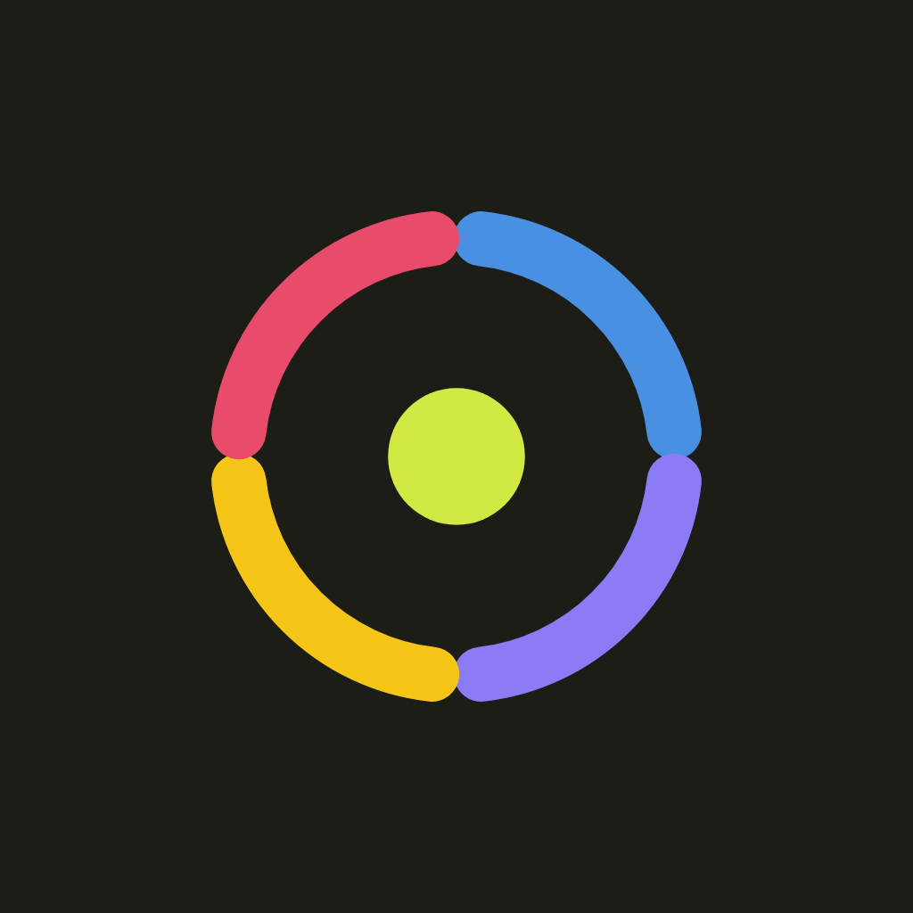
</p>

<h1 align="center">HoYo AIO</h1>

<p align="center">
  <b>Your HoYoverse game notes, check-ins, codes and pity in one place.</b>
</p>

<p align="center">
  
  
  
  
</p>

<p align="center">
  
</p>

---

> **Unofficial fan-made app.** HoYo AIO is not affiliated with, endorsed, sponsored or approved by HoYoverse / COGNOSPHERE / miHoYo. Game names and related trademarks belong to their owners. Your cookie is stored encrypted on your device and is sent only to official HoYoLAB servers.

## What is HoYo AIO?

A companion app for **Genshin Impact**, **Honkai: Star Rail**, **Zenless Zone Zero** and **Honkai Impact 3rd** that reads your own HoYoLAB data and answers the questions you open three different apps for:

| Question                                  | Module                          | What it does                                                                                                                                                 |
| ----------------------------------------- | ------------------------------- | ------------------------------------------------------------------------------------------------------------------------------------------------------------ |
| "Is my Resin / Power / Battery full yet?" | **Dashboard**                   | Stamina ring with time-to-full, currencies, dailies, weeklies and expeditions / assignments with live countdowns. Works offline from the last refresh.        |
| "Did I check in today?"                   | **Daily check-in**              | This month's reward calendar for all four games, a Check In Now button and **auto check-in** at a time you pick, with a history of every run.                |
| "Tell me before it overflows."            | **Notifications**               | Stamina threshold and full, expeditions done, Realm Currency, Transformer, daily reminder, check-in result, cookie expired. Quiet hours included.            |
| "Any new codes or events?"                | **Codes & events**              | New redeem codes and web events from HoYoLAB, with one tap to copy a code and open the official redeem page. No automatic redeeming.                         |
| "How close am I to pity?"                 | **Wish / warp / signal tracker** | Paste your in-game history link once and see pity per banner, 5★ history with pull counts and your 50/50 record. History is kept on the device.             |
| "I want it on my home screen."            | **Widgets**                     | Small 2×1, Medium 2×2 and Large 4×2 widgets with theme, opacity, accent, font size and visible items. Stamina keeps counting up between refreshes.          |

Every notification the app sends is also kept in a **notification log** behind the bell on the dashboard.

## Screenshots

| Dashboard (Genshin)                                    | Dashboard (Star Rail, dark)                                     | Dashboard (ZZZ)                                    |
| ------------------------------------------------------ | --------------------------------------------------------------- | -------------------------------------------------- |
| 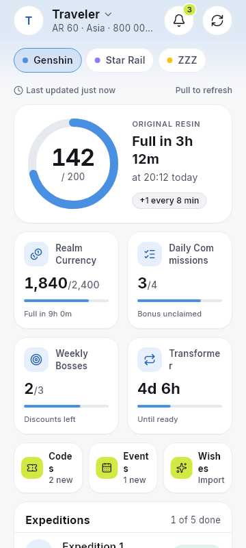 | 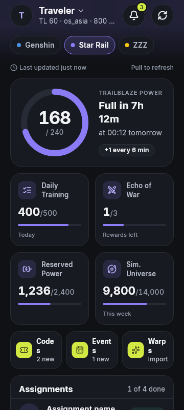 | 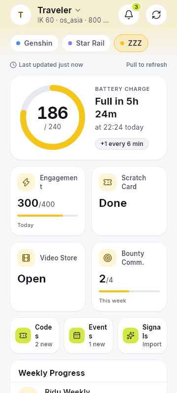 |
| **Wish tracker**                                       | **Wish tracker (dark)**                                         | **Settings**                                       |
| 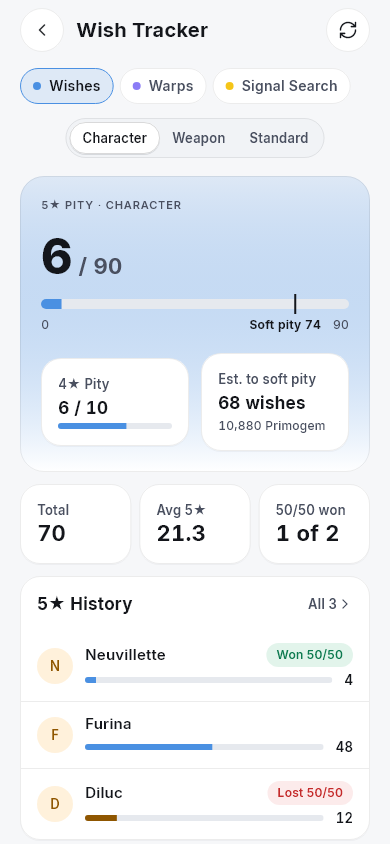 | 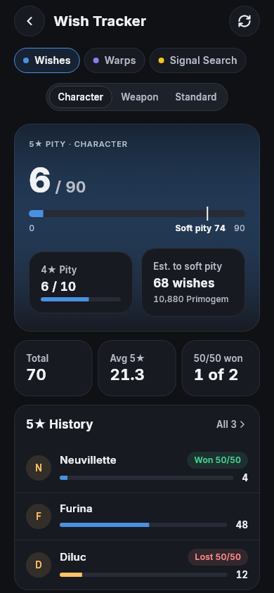 | 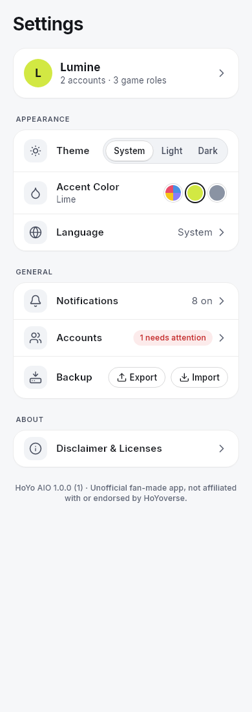 |

Home-screen widgets:

| Small 2×1                                                       | Medium 2×2                                                       | Large 4×2                                                        |
| --------------------------------------------------------------- | ---------------------------------------------------------------- | ---------------------------------------------------------------- |
| 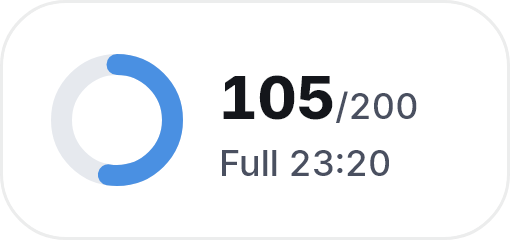 | 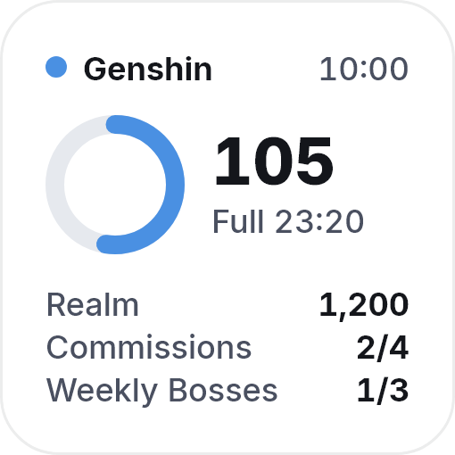 | 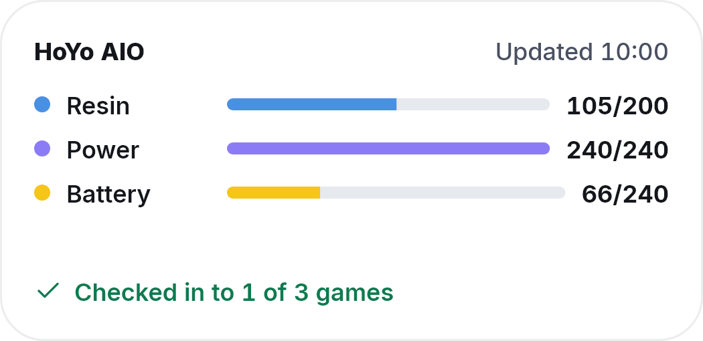 |

Screenshots use made-up sample data.

## Download

Get the latest APK from **[Releases](../../releases)** (`hoyo-aio-vX.Y.Z.apk`, with a `.sha256` checksum next to it).

1. Download the APK on your Android phone and open it.
2. Allow installing from that source when Android asks.
3. Open HoYo AIO, then add your HoYoLAB account with **Log In With HoYoLAB** or **Paste Cookie**.

Updates install over the old version and keep your data, as long as they come from the same Releases page.

## Platforms

| Platform    | Status                                                                                           |
| ----------- | ------------------------------------------------------------------------------------------------ |
| Android 7+  | **Ready.** Signed APK on GitHub Releases. Dynamic color on Android 12+.                         |
| iOS 17+     | Code and widget extension exist and compile in CI, but nothing has been tested on a real iPhone. |

## Privacy

- **No backend, no account, no analytics, no ads.** The only servers the app talks to are official HoYoLAB / HoYoverse hosts.
- **Your cookie never leaves the phone** except inside requests to those hosts. It is encrypted twice: by Android Keystore / iOS Keychain, and again with AES-256-GCM before it is stored.
- A network guard rejects any request to a host that is not on the allowlist, before the cookie is even read.
- Logs strip cookies, tokens and the gacha `authkey`, and shorten UIDs to their last 3 digits.
- **Backups** (Settings › Backup) contain settings, accounts, roles and widget layouts, never cookies. Imported accounts ask you to log in again.
- Android cloud backup is turned off for the app, so its data is not copied off the device.

## How it works

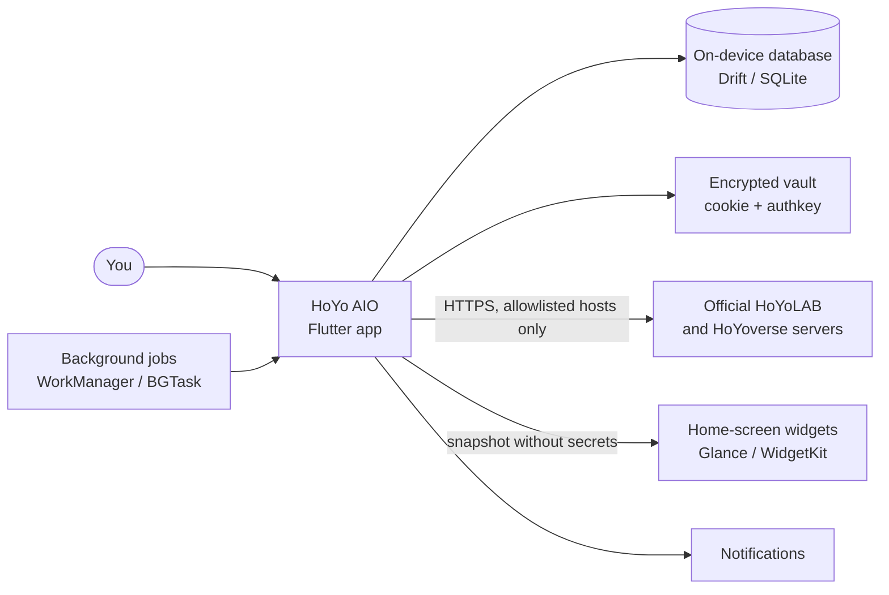

After one refresh the app knows **absolute times**: when stamina is full, when each expedition returns. Countdowns, widgets and notifications are all computed on the phone from those times, so they stay correct without asking HoYoLAB again. Background refresh (every 15 minutes or more, your choice) only corrects the small drift.

### The building blocks

|                                                                                    | Part                                     | Used for                                                    |
| ---------------------------------------------------------------------------------- | ---------------------------------------- | ----------------------------------------------------------- |
|                   | **Flutter 3** (Dart 3)                   | The app on Android and iOS                                  |
|                      | **Riverpod 3**, freezed                  | State, caching and immutable models                         |
|                    | **Drift**                                | On-device database with tested migrations                   |
|                      | **Dio**                                  | HTTP with host allowlist, request signing, retry and redaction |
|            | **Jetpack Glance**                       | Android home-screen widgets                                 |
|                     | **WidgetKit**                            | iOS home-screen widgets                                     |
|                   | **WorkManager**, local notifications     | Background refresh, auto check-in and alerts                |
|             | **GitHub Actions**                       | Checks on every push, signed APK on every release tag       |

### How the code is organised

```
hoyo-aio/
├── lib/
│   ├── app/            entry points, router, theme, settings
│   ├── core/           design system, HoYoLAB config, network, storage,
│   │                   database, errors, logging, translations
│   └── features/       accounts, dashboard, checkin, notifications,
│                       background, home_widgets, codes, events,
│                       tracker, settings, onboarding
├── android/            Android app + Glance widgets (Kotlin)
├── ios/                iOS app + WidgetKit extension (Swift)
├── test/               ~900 unit, widget and golden tests
├── integration_test/   end-to-end flow against a fake HoYoLAB server
├── docs/               API notes, logo, screenshots
└── .github/workflows/  CI and release
```

Each feature is split into `presentation/` (screens and providers), `domain/` (pure logic such as stamina math and pity) and `data/` (API, database).

## Build it yourself

You need **Flutter 3.50+** with the Android SDK and **JDK 21** (the one bundled with Android Studio works).

```bash
git clone https://github.com/Khahaha10/Hoyo-AIO.git
cd Hoyo-AIO
flutter pub get
flutter gen-l10n
dart run build_runner build
flutter run --flavor dev -t lib/main_dev.dart
```

The **dev** flavor installs as "HoYo Dev" next to the normal app and adds a component gallery and debug tools. The **prod** flavor is what users get.

## Useful commands

| Command                                                                 | What it does                                                    |
| ----------------------------------------------------------------------- | --------------------------------------------------------------- |
| `flutter run --flavor dev -t lib/main_dev.dart`                         | Run the dev build                                               |
| `flutter analyze` · `dart format .`                                     | Static checks and formatting (both run in CI)                   |
| `flutter test --exclude-tags golden`                                    | Unit and widget tests, as in CI                                 |
| `flutter test --update-goldens test/goldens`                            | Refresh screenshot tests after a UI change                      |
| `flutter test --update-goldens test/tool/brand_assets_test.dart`        | Redraw the app icon, splash and widget picker previews          |
| `dart run flutter_launcher_icons` · `dart run flutter_native_splash:create` | Turn those images into Android / iOS icons and splash       |
| `flutter build apk --release --flavor prod -t lib/main_prod.dart`       | Release APK                                                     |

## Releasing a new version

1. Raise `version:` in `pubspec.yaml` (for example `1.0.1+2`) and commit.
2. Tag and push: `git tag v1.0.1 && git push origin v1.0.1`.
3. The **Release** workflow builds a signed APK and publishes it with release notes and a checksum.

Signing uses four repository secrets: `ANDROID_KEYSTORE_BASE64`, `ANDROID_KEYSTORE_PASSWORD`, `ANDROID_KEY_ALIAS` and `ANDROID_KEY_PASSWORD`. For signed builds on your own computer, put the same values in `android/key.properties` (never committed).

## Credits

- HoYoLAB API knowledge (endpoints, headers, request signing) comes from **[android_genshin_resin_widget](https://github.com/danggai/android_genshin_resin_widget)** by Donggi Hong, MIT License. Only the API knowledge was used; no code, names or assets were copied. Its license is shown in the app under Settings › Disclaimer & Licenses.
- **[Inter](https://github.com/rsms/inter)** typeface by The Inter Project Authors, SIL Open Font License 1.1.
- Icons by **[Lucide](https://lucide.dev)**.

## Roadmap

- [x] Dashboard, check-in, notifications, widgets for GI / HSR / ZZZ (HI3 check-in)
- [x] Redeem codes, web events, wish / warp / signal tracker
- [x] English and Bahasa Indonesia, light / dark / dynamic color, backup
- [x] Signed Android release on GitHub
- [ ] Performance and accessibility pass (TalkBack, large text, small screens)
- [ ] iOS tested on a real device
